<p align="center">
  
</p>

<p align="center">
  <a href="https://ehtishamuldin.online"></a>
  <a href="https://www.linkedin.com/in/ehtisham-ul-din/"></a>
  
  
</p>

---

### 👨‍💻 About me

```js
const ehtisham = {
  role:        "Lead Software Engineer @ Digital Film Marketing",
  location:    "Lahore, Pakistan 🇵🇰",
  experience:  "6+ years, 200+ web apps shipped",
  focus:       ["Full-stack web", "Internal tools", "Chrome extensions", "Mobile apps"],
  philosophy:  "Small, self-contained, no-bloat code that just works",
  currently:   "Building DOOH / LED-screen ad tech & client web products",
  funFact:     "I build CSS animations for fun 🎨",
};
```

### 🛠️ Tech stack

<p align="center">
  
  <br/>
  
  <br/>
  
</p>

### 🚀 What I build

| | |
|---|---|
| 🖥️ **Web apps & portals** | Laravel / plain-PHP platforms with payments (Stripe), e-signatures and dashboards |
| 🧩 **Chrome extensions** | Monitoring, alerting and lead-scraping tools |
| 📱 **Mobile apps** | NativePHP / Laravel Android apps |
| 🎨 **Creative front-end** | Pure CSS / JS animations and 3D web experiments |

### 📌 Featured projects

| Project | What it is | Tech |
|---|---|---|
| 🌐 [**3D-Webpage**](https://github.com/ehtishamuldin/3D-Webpage) | Interactive 3D web experience |  |
| 🚬 [**Cigarette**](https://github.com/ehtishamuldin/Cigarette) | Animated cigarette in pure HTML & CSS |  |
| 🎬 [**Netflix-like-Logo**](https://github.com/ehtishamuldin/Netflix-like-Logo) | Netflix-style intro logo animation |  |
| 💼 [**Portfolio**](https://github.com/ehtishamuldin/Portfolio) | Personal portfolio website |  |

### 📊 GitHub stats

<p align="center">
  
</p>

<p align="center">
  
  
</p>

<p align="center">
  
</p>

### 🤝 Let's connect

<p align="center">
  Open to freelance work and interesting collaborations — reach out on
  <a href="https://www.linkedin.com/in/ehtisham-ul-din/">LinkedIn</a> or via my
  <a href="https://ehtishamuldin.online">portfolio</a>.
</p>

<p align="center"><sub>Built pixel by pixel, like the LED screens I write software for.</sub></p>
